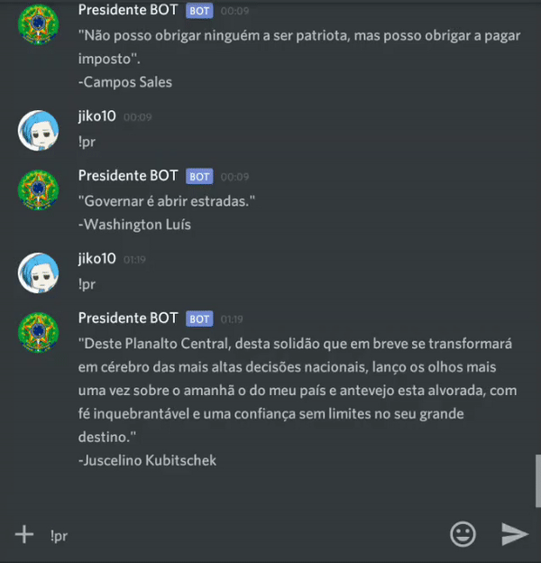

# Presidente BOT :speech_balloon:

A Discord bot that sends random quotes from ~~almost~~ all presidents of Brazil. :mag: :computer:

## Installation :hammer:

Visit [this link](https://discordapp.com/oauth2/authorize?client_id=530209100236324866&scope=bot&permissions=0) to select which server **Presidente BOT** should be added to. You must have a Discord account. After that, it will be configured and ready to use.

## How it works

**Presidente BOT** works through the _-pr_ command, which queries [Pensador](https://www.pensador.com/) and returns a random quote from Brazilian presidents.

**Commands**

- -pr :arrow_right: Sends a random quote
- -help :arrow_right: Help section
- -about :arrow_right: About the BOT
- -status :arrow_right: Number of quotes generated

### Libraries :books:

Made with dedication, care, and:

- [NodeJS](https://nodejs.org/en/)
- [Cheerio](https://github.com/cheeriojs/cheerio)
- [Discord.JS](https://discord.js.org/#/)

### More

[Presidente BOT for Telegram](https://github.com/paulo9mv/presidente-telegram-bot) :iphone:

Contributions are welcome!

:pencil2: **Paulo Viana**
